# ⚡ Awesome Usage-Based & Pay-as-you-go Billing 💳

  

  
  
  
  
  

> 🚀 A curated list of the best **Usage-Based Billing (UBB)**, **Pay-As-You-Go (PAYG)**, and **consumption pricing platforms** — comparing enterprise SaaS billing solutions, high-throughput AI metering engines, and production-ready open-source alternatives.  
> 🌟 Star this repo if you find it useful! 🌟

---

### 🔍 Quick Definitions & Keywords
- 📊 **Usage-Based Billing (UBB):** A revenue model where customers are billed based on actual resource consumption (e.g., API requests, compute hours, storage GB, active users).
- 💸 **Pay-As-You-Go (PAYG):** Pure consumption billing with zero base subscription overhead.
- 🧠 **LLM Token & Agent Metering:** Real-time event ingestion that tracks input tokens, output tokens, and reasoning costs for modern generative AI and agentic software.

---

## 📋 Table of Contents

- [🌐 Sector Overview & Market Dynamics](#-sector-overview--market-dynamics)
- [🟦 SaaS / Hosted Platforms](#-saas--hosted-platforms)
- [🟩 Open-Source Software](#-open-source-software)
  - [Lago](#lago-)
  - [Flexprice](#flexprice-)
  - [Kill Bill](#kill-bill-)
  - [OpenMeter](#openmeter-)
  - [Meteroid](#meteroid-)
  - [Formance](#formance-)
- [📊 Comparison at a Glance](#-comparison-at-a-glance)
- [❓ Frequently Asked Questions (FAQ)](#-frequently-asked-questions-faq)
- [📈 Star History](#-star-history)
- [💖 Support & Community](#-support--community)
- [🤝 Contributing](#-contributing)
- [📄 License](#-license)

---

## 🌐 Sector Overview & Market Dynamics

The global Usage-Based Billing (UBB) and consumption pricing software market is estimated at **$6.8B to $7.4B** (projected to reach ~$11.5B by the early 2030s at a ~7.7% CAGR, with AI/LLM token-metering niches growing above 15%). The sector is **moderately-to-highly fragmented** rather than winner-take-all: no single player controls more than ~15% market share due to distinct tier bifurcations across legacy enterprise ERP suites (Zuora, Salesforce), high-frequency AI/API metering engines (Metronome, Orb, OpenMeter), and self-hosted open-source stacks (Lago, Flexprice).

---

## 🟦 SaaS / Hosted Platforms

Commercial, cloud-hosted Usage-Based and Pay-as-you-go Billing platforms. These are not open-source but are included as reference points for feature comparison.

| Platform | Company Size (Valuation / Revenue) | Type | Starting Pricing | Free Tier / Trial Limit |
|---|---|---|---|---|
| **Chargebee** | Valuation: ~$3.5B (Est. Revenue: ~$200M–$300M ARR) | Subscription & hybrid usage billing | Free up to $250k cumulative revenue, then 0.75% overage fee (or Starter from $0/mo; Performance tier from $599/mo) | Free forever for up to $250,000 in lifetime billing (up to $1M revenue for qualifying startups) |
| **Zuora** | Valuation: $1.7B (Acquired by Silver Lake/GIC; ARR: ~$410M–$420M) | Enterprise metered billing & revenue automation | Enterprise contracts typically start at ~$75,000/year (billed annually based on volume/edition) | 30-day evaluation trial / sandbox environment available upon enterprise sales qualification |
| **Metronome** | Valuation: $1.0B (Acquired by Stripe; $130M venture funding) | High-volume AI & API consumption billing | Starter plan: 0.8% of billings + $0.04 per 1,000 ingested events (Custom enterprise) | Free tier available (no upfront monthly subscription platform fee; pay-per-event/billings) |
| **Orb** | Valuation: $335M (Acquired by Adyen; $44.1M venture funding) | Developer-centric usage billing infrastructure | Paid plan starts at $20/month (or $200/year for up to 5 Orbs; Custom enterprise) | Free forever plan with 10 Orbs included |
| **m3ter** | Valuation: ~$140M (Acquired by Salesforce; $31.5M funding) | Metered rating engine & pricing operations | Custom monthly base platform fee (typically starts with custom enterprise deployments) | No public self-serve free tier; custom proof-of-concept (PoC) / sandbox provided upon demo request |
| **Amberflo** | Valuation: ~$60M–$80M est. ($20M venture funding raised) | Real-time cloud metering & cost calculation | Free tier; paid startup tiers start at $99/month (or pay-as-you-go overages) | Free forever plan includes up to 1,000,000 meter events per month |
| **Togai** | Valuation: ~$20M–$30M est. ($3.1M seed; Acquired by Zuora) | Usage metering & pricing orchestrator | Historically Starter from $0/mo; Growth tier at 0.5% of invoice amount (now part of Zuora) | Free Starter tier offered 1,000,000 events/month and up to $10,000 in monthly invoice volume |
| **Octane** | Valuation: ~$15M–$25M est. ($8M–$10M funding; Acquired by Stripe) | Usage-based pricing & monetization engine | Seed-stage developer API platform (Acquired by Stripe; custom enterprise quote) | Custom developer sandbox / pilot trial access upon consultation request |
| **Monetize360** | Valuation: ~$12M–$18M est. ($3.7M venture funding raised) | Revenue infrastructure for consumption & outcome models | Custom enterprise platform quotation based on high-volume data streams & modules | No self-serve free tier; custom evaluation lab / sandbox environment granted via enterprise sales demo |

---

## 🟩 Open-Source Software

Self-hosted, community-driven Usage-Based Billing platforms, sorted by GitHub stars (descending).

### Lago 
**Repo:** [getlago/lago](https://github.com/getlago/lago) | **Stack:** Ruby / PostgreSQL / ClickHouse / Redis | **License:** AGPL-3.0  
Lago is an established open-source metering and usage-based billing platform. It handles usage-based, subscription, prepaid, and hybrid pricing on a unified engine. The open-source edition provides core billing infrastructure: high-throughput usage ingestion, billable metrics, plans, subscriptions, invoicing, and payment processor integrations (Stripe, Adyen, GoCardless).  
**Best for:** Engineering teams needing a mature, self-hosted billing engine with deep extensibility and hybrid subscription capabilities.

### Flexprice 
**Repo:** [flexprice/flexprice](https://github.com/flexprice/flexprice) | **Stack:** Go / PostgreSQL / ClickHouse | **License:** AGPL-3.0  
Flexprice is a developer-first, open-source usage-based pricing and billing infrastructure. It provides real-time event metering, wallet and prepaid top-ups, no-code UI for pricing configurations, tiered and graduated pricing models, and feature entitlement controls to govern application access dynamically.  
**Best for:** Developers building modern SaaS and AI applications that need lightweight real-time metering, wallet credit balances, and entitlement gating.

### Kill Bill 
**Repo:** [killbill/killbill](https://github.com/killbill/killbill) | **Stack:** Java / MySQL / PostgreSQL / OSGi | **License:** Apache-2.0  
Kill Bill is a battle-tested, enterprise open-source subscription billing and payments platform. While originally designed for complex recurring subscription workflows, Kill Bill supports metered consumption, custom rating plugins, usage rollups, and invoice generation through its modular architecture and usage plugins.  
**Best for:** Enterprise teams requiring a robust, highly modular Java billing backbone with flexible payment processor routing and custom plugin systems.

### OpenMeter 
**Repo:** [openmeterio/openmeter](https://github.com/openmeterio/openmeter) | **Stack:** Go / PostgreSQL / ClickHouse / Kafka | **License:** Apache-2.0  
OpenMeter is an open-source real-time metering and billing engine optimized for high-volume event ingestion and low-latency balance tracking. It ingests events via CloudEvents format, defines meters with flexible aggregations (SUM, COUNT, AVG, MIN, MAX), and queries usage in real time. Features include tiered/graduated pricing, prepaid credits, entitlement tracking, customer portals, and first-class LLM token cost tracking under a permissive Apache-2.0 license.  
**Best for:** AI, agentic, and DevTool companies needing high-throughput real-time token metering and entitlement limits with an Apache-2.0 license.

### Meteroid 
**Repo:** [meteroid-oss/meteroid](https://github.com/meteroid-oss/meteroid) | **Stack:** Rust / PostgreSQL | **License:** AGPL-3.0  
Meteroid is a high-performance open-source pricing and billing infrastructure written in Rust. It supports real-time usage event ingestion, subscription management, usage-based billing, cost limiting, automated invoicing, grandfathering of legacy plans, pricing experiments, and revenue analytics.  
**Best for:** Performance-sensitive teams looking for a high-efficiency Rust-based metering and usage billing engine.

### Formance 
**Repo:** [formancehq/stack](https://github.com/formancehq/stack) | **Stack:** Go / PostgreSQL | **License:** Open Source  
Formance Stack is an open-source financial orchestration and programmable ledger engine. While acting as a foundational ledger for financial transactions, it enables developers to track usage flows, map consumption credits into double-entry ledgers, and orchestrate complex pay-as-you-go settlement and payout flows across multiple providers.  
**Best for:** Fintech and platform teams requiring double-entry ledger accuracy for complex pay-as-you-go money flows, wallets, and multi-party consumption.

---

## 📊 Comparison at a Glance

| Software | License | Stack | Self-Hosted | LLM Token Tracking | Best For |
|---|---|---|---|---|---|
| **Chargebee** | Proprietary | Cloud | ❌ | Via events | Subscription + usage hybrid |
| **Zuora** | Proprietary | Cloud | ❌ | ✅ (committed usage) | Enterprise finance metering |
| **Metronome** | Proprietary | Cloud | ❌ | ✅ (group keys) | High-volume AI/API billing |
| **Orb** | Proprietary | Cloud | ❌ | ✅ (event dimensions) | Developer-friendly usage billing |
| **m3ter** | Proprietary | Cloud | ❌ | Via events | Metered billing configuration |
| **Amberflo** | Proprietary | Cloud | ❌ | ✅ (dimensions) | Cost calculation + dimensions |
| **Togai** | Proprietary | Cloud | ❌ | Via events | Flexible pricing models |
| **Octane** | Proprietary | Cloud | ❌ | Via events | Real-time usage API |
| **Monetize360** | Proprietary | Cloud/VPC/on-prem | (Enterprise) | ✅ (tokens/agents) | Consumption + outcome revenue |
| **Lago** | AGPL-3.0 | Ruby / PostgreSQL / ClickHouse | ✅ | Via events | Proven open-source billing engine |
| **Flexprice** | AGPL-3.0 | Go / PostgreSQL / ClickHouse | ✅ | ✅ (real-time tokens) | Developer-first usage & credit wallets |
| **Kill Bill** | Apache-2.0 | Java / MySQL / PostgreSQL | ✅ | Via plugins | Enterprise open-source billing & payments |
| **OpenMeter** | Apache-2.0 | Go / ClickHouse / Kafka | ✅ | ✅ (first-class) | Real-time AI/DevTool metering |
| **Meteroid** | AGPL-3.0 | Rust / PostgreSQL | ✅ | Via events | High-performance Rust billing infrastructure |
| **Formance** | Open Source | Go / PostgreSQL | ✅ | Ledger tracking | Programmable ledgers & consumption flows |

---

## ❓ Frequently Asked Questions (FAQ)

### What is the difference between subscription billing and usage-based billing?
Traditional subscription billing charges a fixed recurring fee (e.g., $49/month) regardless of activity. Usage-based billing (or metered consumption) ingests granular telemetry events (API hits, LLM tokens, gigabytes transferred, compute seconds) and computes charges dynamically based on tiered, graduated, or volume rate cards.

### Which open-source usage-based billing tool is best for AI / LLM applications?
**OpenMeter** (Apache-2.0) and **Flexprice** (AGPL-3.0) provide first-class support for low-latency streaming event ingestion, prepaid wallet drawdowns, and token cost tracking designed specifically for LLM APIs and agentic workloads.

### How do usage-based billing platforms connect with payment gateways?
Metering engines like Lago, OpenMeter, and Metronome act as the calculation and rating layer. Once an invoice is generated at the close of a billing cycle, the platform delegates fund collection to payment gateways such as Stripe, Adyen, Braintree, or GoCardless via webhooks and native API connectors.

---

## 📈 Star History

---

## 💖 Support & Community

Thank you so much for checking out **Awesome Usage-Based & Pay-as-you-go Billing**! 🙌

If you find this curated resource helpful for your projects, architecture design, or evaluation workflows, please consider supporting the project:

- ⭐ **Star this repository** to show your appreciation and help others discover it.
- 🍴 **Fork and contribute** your favorite usage-based billing tools, SDKs, or insights.
- 📢 **Share with fellow developers**, founders, and DevOps engineers on Twitter/X, LinkedIn, Reddit, or Discord.
- ☕ **Buy me a coffee / Sponsor:** If you would like to support ongoing maintenance and new curated additions, you can sponsor through the [GitHub Sponsors Dashboard](https://github.com/sponsors/ishandutta2007):

  
  

---

## 🤝 Contributing

Contributions are welcome! If you know of an open-source Usage-Based or Pay-as-you-go Billing platform that should be listed here, please open a pull request with:

- Project name and URL
- Brief description (1–2 sentences)
- Stack and license
- Why it stands out

Please ensure the project is actively maintained (releases within the last 12 months) and genuinely open-source.

---

## 📄 License

This list is released under CC0 1.0 Universal (Public Domain). The software projects listed retain their respective licenses.

---

⭐ **If this list helped you discover a useful tool, please star the repo!** ⭐
